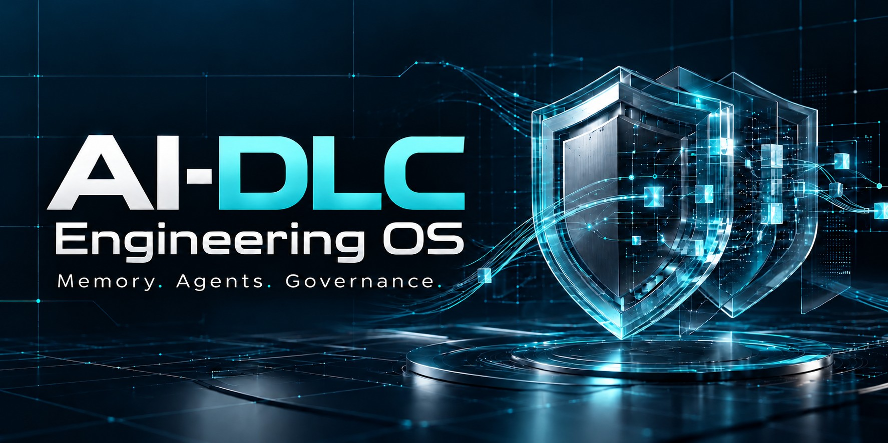
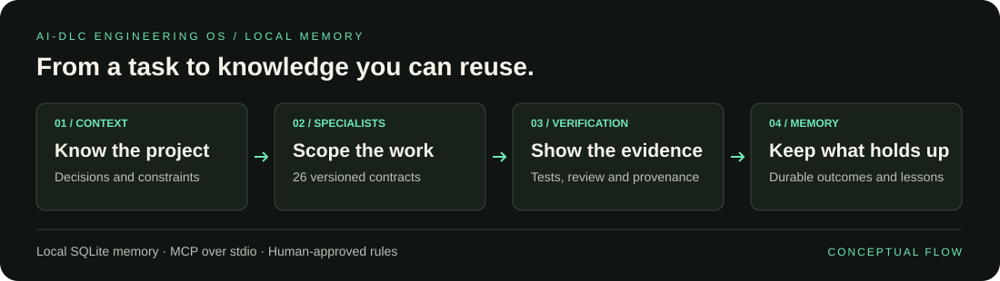

<div align="center">

# AI-DLC Engineering OS

**Execução verificável:** `ai-dlc verify` vincula evidências de comandos ao repositório
correto e aos arquivos atuais. `ai-dlc eval` avalia seis cenários comportamentais;
`ai-dlc swarm recover` recupera o contexto das tarefas existentes.
[Fluxo e limites](docs/VERIFIED_EXECUTION.md). Testes sintéticos validam o avaliador;
a eficácia de agentes reais e a economia de tokens ainda não foram medidas.



**[English](README.md) | [Português (Brasil)](README.pt-BR.md) | [Español](README.es.md)**

### Seus agentes de código esquecem tudo entre sessões. Isso resolve o problema.

**Memória local para decisões, incidentes e convenções. Você aprova o que vira regra.**

[](https://github.com/jcamargos/ai-dlc-engineering-os/actions/workflows/ci.yml)
[](https://pypi.org/project/ai-dlc-engineering-os/)
[](https://pypistats.org/packages/ai-dlc-engineering-os)
[](LICENSE)


**[Início rápido](#início-rápido) · [Por que não CLAUDE.md?](#por-que-não-usar-apenas-claudemd-ou-agentsmd) · [Evidências](#evidências) · [Como funciona](#como-funciona) · [Perguntas frequentes](#perguntas-frequentes)**



**Para Claude Code, Codex e VS Code — via MCP. Gratuito e open source (Apache 2.0).**

</div>

---

Na segunda-feira, seu agente aprende que operações de escrita em pagamentos precisam de chaves
de idempotência. Na terça, em outra sessão ou editor, ele começa do zero. O **AI-DLC Engineering OS**
oferece aos agentes compatíveis com MCP na sua máquina a mesma memória persistente por projeto,
além de 26 contratos de especialistas. Nada vira regra sem evidência e sua aprovação.

O servidor de memória roda localmente com SQLite: sem conta, telemetria ou serviço hospedado.
Seu cliente de IA controla qual contexto recuperado envia ao provedor do modelo.

## Início rápido

Instale o [uv](https://docs.astral.sh/uv/getting-started/installation/) e execute este único
comando no Windows, macOS ou Linux:

```bash
uvx ai-dlc-engineering-os setup
```

Escolha Codex, Claude Code ou VS Code, revise as alterações propostas e confirme. O assistente
instala um ambiente persistente, faz backup da configuração e da memória existentes, registra
o MCP e verifica os editores escolhidos. Reinicie o editor depois. O VS Code precisa ter sido
aberto pelo menos uma vez para criar seu perfil padrão.

Abra seu projeto e pergunte:

```text
O que já sabemos sobre este projeto antes de eu mexer no fluxo de pagamento?
```

No Claude Code e no Codex, a instalação adiciona instruções a `CLAUDE.md` e `AGENTS.md` para que
o agente carregue decisões, lições e incidentes abertos do projeto antes de trabalhos relevantes.
Quando tomar uma decisão que vale guardar, diga isso: “lembre que usamos chaves de idempotência
nas operações de escrita em pagamentos”. Ela estará disponível na próxima sessão, em qualquer
editor configurado.

Adicione `--editors codex,claude --dry-run` para visualizar sem aplicar alterações. Para instalação
sem interação, escolha `--editors` explicitamente e adicione `--yes`. O [guia de instalação](docs/INSTALLATION.md)
explica requisitos, atualizações, versões fixadas, backups e desinstalação.

## Por que não usar apenas CLAUDE.md ou AGENTS.md?

Continue usando esses arquivos. Eles são o lugar adequado para instruções que você escreve
manualmente. O projeto acrescenta recursos que um arquivo estático não oferece tão bem:

| | Arquivo de instruções | AI-DLC Engineering OS |
|---|---|---|
| Quem escreve | Você, manualmente | Agentes propõem; você aprova regras |
| Compartilhamento entre editores | Um arquivo por ferramenta | Um banco local para todos os editores configurados |
| Crescimento sem sobrecarregar o contexto | Arquivo inteiro carregado a cada vez | Recuperação apenas do que é relevante para a tarefa |
| Conhecimento desatualizado | Editado sem histórico explícito | Substituído com histórico; repositório e testes prevalecem sobre a memória |
| Segredos colados por acidente | Salvos como foram escritos | Recusados na gravação |

## Evidências

Cada número abaixo vem de um comando deste repositório que você pode executar novamente.

| Verificação | Resultado | Como reproduzir |
|---|---|---|
| Recuperação entre sessões (animação acima) | Decisão recuperada por outro processo; credencial recusada e ausente do contexto | `python scripts/demo_cross_session.py` |
| Confiabilidade das reservas de tarefas do swarm, 500 tarefas, 8 workers | 500/500 concluídas, 0 duplicadas, 0 perdidas | `python benchmarks/run_reliability.py --tasks 500 --workers 8` |
| Busca em 1.000 memórias | 200/200 buscas com resultados, média de 104 ms | `ai-dlc benchmark --operations 1000 --searches 200` |
| Suíte de testes | Suíte atual, incluindo MCP real por stdio e migração do grafo | `pytest` |

Medições em um contêiner Linux com 2 vCPUs e Python 3.13. São referências de uma máquina,
não garantias de capacidade; consulte o [protocolo de benchmarks](benchmarks/README.md).
A CI verifica que a demonstração e os dois benchmarks continuam executáveis.

## Recursos

| Recurso | O que faz |
|---|---|
| **Memória que continua válida** | FTS5/BM25 e busca vetorial local em decisões, lições, incidentes e resultados. Substituição com histórico, sem sobrescrita silenciosa. Repositório e testes sempre prevalecem sobre a memória. |
| **Segurança por padrão** | Credenciais são recusadas na gravação. Conteúdo semelhante a instruções é sinalizado e excluído do contexto. Exclusão definitiva de dados que não deveriam estar ali. |
| **Governança humana** | Agentes propõem; só humanos aprovam regras (`ai-dlc-admin`, apenas em terminal interativo). |
| **26 especialistas** | Cada um com contrato, procedimento, checklist, formato de saída e regras de encaminhamento para intervenção humana. |
| **Evolução medida dos agentes** | Casos de referência, verificações de qualidade, segurança e regressão, etapas shadow → canary → active, comprovantes encadeados por hash e detecção de desvios. |

## Como funciona



Uma sessão típica, conduzida pelo agente por meio das ferramentas MCP:

1. `resolve_project_id` → `get_project_context(project_id, task)`: decisões relevantes, lições e incidentes abertos.
2. `list_agents` → `get_agent_context("principal-architect", project_id)`: especialista adequado, com as regras aprovadas do projeto.
3. Execute o trabalho. Persista apenas o que é durável: `save_decision`, `record_learning`, `record_incident`.
4. `record_task_outcome` com evidências. Lições permanecem **candidatas** até serem verificadas; regras exigem **aprovação humana**.

A memória fica em um único arquivo SQLite (`~/.ai-dlc/memory/memory.db`, modo WAL), compartilhado
pelos clientes na máquina. Instalações anteriores à 3.2.0 continuam usando `~/.codex/ai-dlc-memory`
automaticamente. As migrações de esquema são versionadas e executadas no mesmo banco, com backup prévio.
Saiba mais: [Arquitetura](docs/ARCHITECTURE.md) · [Modelo de aprendizado](docs/LEARNING_MODEL.md) ·
[Evolução dos agentes](docs/AGENT_EVOLUTION.md).

## Grafo de importações do repositório (opcional)

Disponível neste checkout; instale esta revisão para usar o grafo. A versão do PyPI pode estar atrás da main.

Antes de alterar um módulo compartilhado, descubra quais arquivos o importam.
O grafo local retorna dependências ou dependentes transitivos com linhas de origem,
profundidade limitada e cobertura. Python usa AST; JavaScript/TypeScript usa uma
aproximação léxica. Cada consulta verifica a atualização e recusa resultados antigos.

Configure `AI_DLC_GRAPH_ROOTS` com as raízes Git locais autorizadas e use
`index_repository_graph`, `repository_graph_status` e `query_repository_graph`.
O acesso fica desativado por padrão, não armazena corpos de código e não exige serviço externo.
É um grafo de importações, não um grafo completo de chamadas nem uma promessa medida de economia de tokens.
Consulte o [guia de configuração, limitações e reversão](docs/REPOSITORY_GRAPH.md).

```shell
python scripts/demo_repository_graph.py
```

## Os 26 agentes

| Área | Agentes |
|---|---|
| Coordenação | `orchestrator`, `planner-requirements`, `product`, `research`, `knowledge-curator` |
| Arquitetura e desenvolvimento | `principal-architect`, `backend`, `frontend`, `data-database`, `integration-api`, `migration`, `ai-llm`, `ux-product-design`, `developer-experience` |
| Qualidade | `code-review`, `qa-verification`, `performance` |
| Segurança | `security`, `threat-model`, `red-team`, `governance-compliance` |
| Operações | `platform-sre`, `observability`, `incident-response`, `release`, `cloud-finops` |

Os contratos ficam em [`contracts/agent_contracts.json`](contracts/agent_contracts.json) e os guias em
[`src/ai_dlc_mcp/agents/`](src/ai_dlc_mcp/agents/). No Claude Code, também estão disponíveis como
subagentes `ai-dlc-*`.

A instalação de subagentes nativos para Codex, VS Code/Copilot e Cursor está disponível
nesta versão do código-fonte; veja [agentes nativos](docs/NATIVE_AGENTS.md) para formatos,
instalação e verificação nos editores. As definições herdam o modelo e as permissões do cliente.

## Comandos

A instalação disponibiliza estes comandos no ambiente persistente de ferramentas do uv (`uv tool dir`):

| Comando | Finalidade |
|---|---|
| `ai-dlc-admin` | Governança humana: `candidates`, `rules approve/reject`, `learnings verify`, `releases`, `purge`, `merge-projects`, `export`, `backup`, `audit` |
| `ai-dlc-install install \| uninstall \| doctor` | Registrar, remover ou verificar o servidor MCP no Codex, Claude Code e VS Code |
| `ai-dlc init` | Adicionar configuração por repositório (`--project-mcp` também escreve `.mcp.json`) |
| `ai-dlc doctor` | Verificar a instalação local |

<details>
<summary><strong>Avançado: swarms, Mission Control, hooks e SDKs</strong></summary>

Esses recursos são opcionais para o fluxo de memória descrito acima.

- **Swarms** (`ai-dlc swarm …`): grafos persistentes de tarefas com dependências, reservas atômicas e worktrees Git isoladas.
- **Mission Control** (`ai-dlc mission-control`): painel de controle local, restrito a loopback por padrão.
- **Hooks**: eventos de sessão, prompt, pós-ferramenta e encerramento pelo plugin incluído; falhas não bloqueiam o fluxo.
- **Clientes SDK** para [Python e TypeScript](sdk/typescript/README.md) conectam-se a um servidor MCP Streamable HTTP
  apenas quando você configura um destino (`AI_DLC_REMOTE_URL`).
- **Federação** fica desativada, salvo quando `AI_DLC_ENABLE_FEDERATION=1`.

Consulte os [recursos avançados](docs/ADVANCED.md), incluindo identificadores antigos mantidos por compatibilidade.

</details>

## Modelo de segurança

- **Gravação:** segredos (chaves de API, tokens, chaves privadas, strings de conexão) são recusados antes do armazenamento.
- **Leitura:** conteúdo semelhante a prompt injection é sinalizado e excluído dos pacotes de contexto;
  o contexto é entregue como *dados, não instruções*.
- **Ações exclusivas de humanos:** aprovações e exclusões definitivas exigem terminal interativo e confirmação digitada,
  que agentes em shells não interativos não conseguem fornecer.
- **Rede:** nenhuma por padrão. O Mission Control usa loopback e rejeita hosts fora dele.

Relate vulnerabilidades de forma privada; consulte [SECURITY.md](SECURITY.md).

## Perguntas frequentes

<details>
<summary><strong>Meu código ou minha memória saem da máquina?</strong></summary>

O servidor MCP armazena memória localmente em SQLite e não tem telemetria. Seu cliente de IA
pode enviar o contexto recuperado ao provedor do modelo, conforme sua configuração.
Federação e conexões remotas por SDK são opcionais.

</details>

<details>
<summary><strong>Claude Code e Codex compartilham a mesma memória?</strong></summary>

Sim. Clientes configurados com o diretório de dados padrão usam o mesmo banco. Assim,
uma decisão registrada em um fica disponível nos outros.

</details>

<details>
<summary><strong>Instalei uma versão anterior. Onde está minha memória?</strong></summary>

Continua em `~/.codex/ai-dlc-memory` e permanece em uso; nada é movido. Para adotar o novo
local, feche os editores e mova essa pasta para `~/.ai-dlc/memory`.

</details>

<details>
<summary><strong>A instalação sobrescreve minha configuração de agentes ou MCP?</strong></summary>

O instalador edita seu próprio bloco demarcado ou registro de servidor em `AGENTS.md`,
`CLAUDE.md` e na configuração MCP, mantendo backups com data e hora.

</details>

<details>
<summary><strong>Um agente pode aprovar suas próprias regras?</strong></summary>

Não. Agentes podem propor regras; a aprovação exige `ai-dlc-admin` em um terminal interativo.
Os contratos de especialistas orientam o agente do cliente; não treinam nem substituem seu modelo.

</details>

## Documentação

Os guias técnicos abaixo estão em inglês.

| Guia | Conteúdo |
|---|---|
| [Instalação](docs/INSTALLATION.md) | Configuração, atualizações, backups e desinstalação |
| [Arquitetura](docs/ARCHITECTURE.md) | Clientes MCP, SQLite, recuperação de contexto e limites de confiança |
| [Modelo de aprendizado](docs/LEARNING_MODEL.md) | Evidências, verificação e ciclo de vida do conhecimento |
| [Evolução dos agentes](docs/AGENT_EVOLUTION.md) | Avaliações, versões e desvios |
| [Recursos avançados](docs/ADVANCED.md) | Swarms, Mission Control, hooks e recursos opcionais |
| [Benchmarks](benchmarks/README.md) | Protocolo de medição reproduzível |
| [Política de segurança](SECURITY.md) | Controles de segurança e relato de vulnerabilidades |
| [Histórico de alterações](CHANGELOG.md) | Histórico de versões |

## Desinstalação

Execute o comando instalado `ai-dlc-install uninstall --no-cli` antes de
`uv tool uninstall ai-dlc-engineering-os`. A memória é preservada.
Consulte os [detalhes de desinstalação](docs/INSTALLATION.md#uninstall), incluindo instalações pelos scripts do repositório.

## Como contribuir

Issues e pull requests são bem-vindos. Consulte [CONTRIBUTING.md](CONTRIBUTING.md) (assinatura DCO:
`git commit -s`) e o [histórico de alterações](CHANGELOG.md). Sem afiliação com Anthropic, OpenAI,
Microsoft ou GitHub.

---

Criado por José Camargo · [LinkedIn](https://www.linkedin.com/in/joseacamargo) · [Instagram @jcamarguinho](https://www.instagram.com/jcamarguinho)
