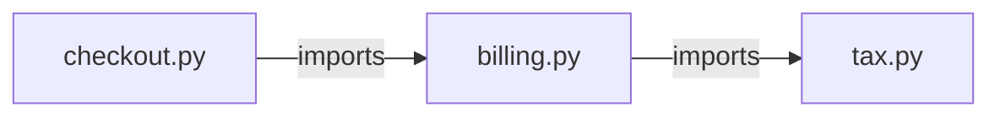

# Local repository graph

AI-DLC Engineering OS can index file imports in a registered local Git repository and
answer “what depends on this file?” or “what does this file depend on?”. It is
an optional local MCP capability, available in this source checkout. Installing
or deploying a different release does not automatically add these tools.

## Design and boundaries

The graph is a disposable structural index. Engineering memory keeps decisions
and verified lessons; the graph keeps relative paths, import relationships,
line numbers, extraction methods, a content fingerprint, and the indexed commit.
Source bodies and import literals are not stored in the graph or its audit event.

Three options were considered: shelling out to Graphify, adding a parser/database
service, or using a small local adapter. This implementation uses a native
adapter without a new dependency or service. Python uses the standard-library
AST; JS/TS uses a conservative lexical scanner. The schema and extraction module
are separate from storage so a stronger parser can replace this adapter later.
Graphify is not installed, invoked, or required.

The API is a **file-import graph**, not a full call graph, semantic knowledge
graph, type checker, or proof of complete change impact. JS/TS edges are labeled
`js_ts_lexical` and must be checked against code. Aliases, package exports,
conditional resolution, regex literals containing import-like text, computed
imports, runtime dispatch and cross-service calls are not fully modeled.
Python resolution supports repository-root and `src/` layouts, including relative
imports; custom import hooks and search paths are not modeled. Ambiguous targets
are left unresolved. Parse failures and omitted files are reported in coverage.

## Enable explicitly

1. Install this checkout with the local installer or into your development
   environment. Git must be available to the MCP server process.
2. Set `AI_DLC_GRAPH_ROOTS` in that process's environment to the absolute Git
   roots it may read. Separate entries with `;` on Windows or `:` on POSIX.
   Prefer exact repository roots rather than a whole home directory. Without
   this setting, graph filesystem access is denied.
3. Restart the local MCP host so it loads the updated code and environment.
4. Use `bootstrap_project` to register the selected project's absolute
   `repo_path`. The path must be the Git root, not a subdirectory.

For an already configured stdio client, add the environment variable using its
supported per-server environment settings. A variable set in an unrelated
terminal does not change the environment of an already running desktop client.
The graph reads files on the machine running the MCP server. A remote server
cannot inspect your local checkout unless that checkout is present on its host.

## MCP workflow

Discover the connected server's tool schemas before calling them. Example
arguments below assume project `demo` is registered and its root is allowed:

```json
{"project_id": "demo"}
```

Pass these arguments to `index_repository_graph` to create or refresh the index,
or to `repository_graph_status` to check its coverage and freshness.

```json
{"project_id": "demo", "path": "src/auth.py", "direction": "dependents", "depth": 2, "limit": 30}
```

Pass these arguments to `query_repository_graph`. Use `dependencies` for outgoing
imports. Paths use forward slashes and are relative to the registered root.
Each returned edge includes `source`, `target`, `line`, `method`, and traversal
`distance`. Cycles terminate through a visited-node set. The result flags
truncation; an empty result is not proof that a change has no runtime impact.

### Freshness is checked on every query

Every status/query call recomputes source hashes and compares the fingerprint,
commit and extraction version. Uncommitted edits, supported new untracked files,
deletions and branch changes invalidate the snapshot. Queries refuse to return
stale edges and ask for `index_repository_graph` again. Indexing scans twice to
reject ordinary concurrent changes and atomically replaces the old snapshot.
A failed refresh leaves the previous index intact; queries still validate it.

This is continuous validation at query time, not a background file watcher.
It avoids hidden CPU consumption and filesystem writes between requests.
Freshness describes the observed scan, not a lock on the working tree: code can
change immediately afterward. Coordinate writers before making a critical decision.

## Scope, budgets, and safety

- Inventory comes from Git tracked files plus untracked files not ignored by Git.
- Hidden paths, common dependency/build/output folders, `.min.js`, `.d.ts`,
  unsupported extensions and paths longer than 512 UTF-8 bytes are excluded.
  Tracked files are not excluded merely because a later `.gitignore` matches them.
- Supported extensions: `.py`, `.js`, `.jsx`, `.ts`, `.tsx`, `.mjs`, `.cjs`, `.mts`, `.cts`.
- Symlinks, Windows reparse points, non-regular files and paths outside the root
  are rejected. Unreadable or unsafe candidates appear as coverage issues.
- Up to 5,000 source candidates, 512 KiB per file, 32 MiB read source data,
  20,000 edges and 8 MiB stored JSON. Oversized individual files are skipped;
  aggregate overflow fails the refresh. UTF-8/UTF-8-BOM sources are supported.
- Git runs without a shell, with a 10-second timeout per command, no fsmonitor,
  no inherited `GIT_*` overrides, and no repository code execution. Its inventory
  output is spooled to a temporary file and rejected above 4 MiB.
- Queries allow depth 1–5, limit 1–100, and at most 12,000 serialized edge bytes,
  plus bounded metadata and up to 10 coverage issues. Limits are not token counts.
- All reads/writes are scoped by workspace and project. The graph table has a
  composite ownership foreign key. Index updates and audit events commit together.
- Local repository paths and source text remain untrusted data, not instructions.
  The local OS account and database administrator remain trusted boundaries;
  this does not sandbox a hostile process racing filesystem changes.

No LLM, API key, network upload, package installation, Git hook, or code execution
is needed to extract or query this graph. The MCP host may still send returned
metadata to its model provider, just as it does with other tool results.

## Demonstrate and verify

```shell
python scripts/demo_repository_graph.py
python -m pytest tests/test_repository_graph.py -q
```

The demo creates an isolated temporary Git repository and SQLite database, shows
transitive dependents, changes a source file, proves that the old graph is refused,
then refreshes it. It makes no persistent changes to your MCP configuration or
project memory. The test suite covers isolation, exclusions, stale detection,
cycles, budgets, concurrent edits, parsing, and MCP inventory parity. On Windows,
the symlink test requires permission to create links; Linux CI exercises it.



Querying dependents of `tax.py` returns `billing.py` at distance 1 and
`checkout.py` at distance 2, with a source line for each import edge. The separate
`tests/test_graph_mcp.py` test exercises tool discovery, indexing, querying and
stale refusal over the actual MCP stdio transport with the declared SDK.

## Operations and rollback

An index response exposes coverage and counts; a query returns a freshness
status, evidence lines and truncation. `graph.indexed` audit events contain
fingerprint, node/edge counts and extractor version, with no source text.

The SQLite schema change is additive. To disable graph access, remove
`AI_DLC_GRAPH_ROOTS` and restart the server. Older runtime code ignores the new
table; no destructive migration is needed for rollback. Re-index after an
extractor upgrade. Do not put generated graph snapshots into durable lessons.

No measured token saving, performance SLA, hosted availability or full-program
analysis is claimed. Compare completed tasks with and without the graph before
publishing an efficiency claim.
